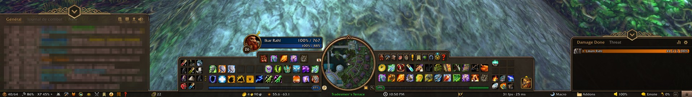
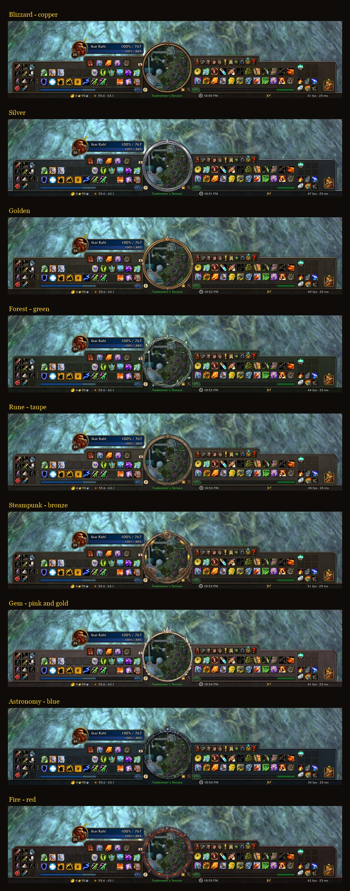
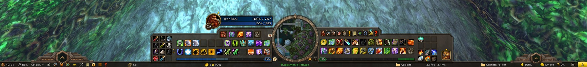
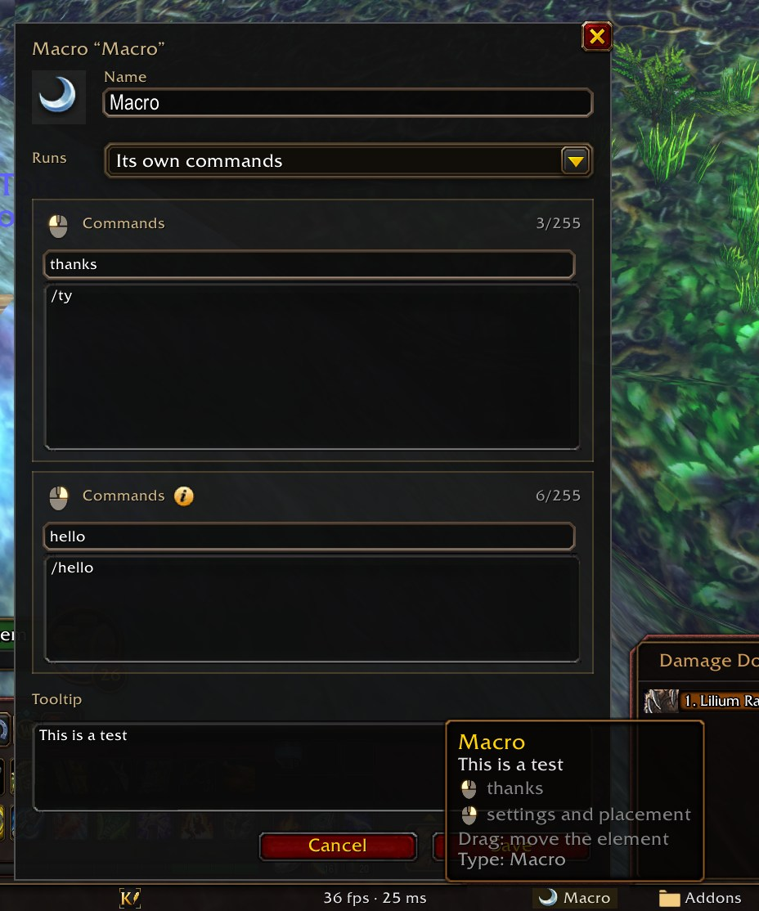
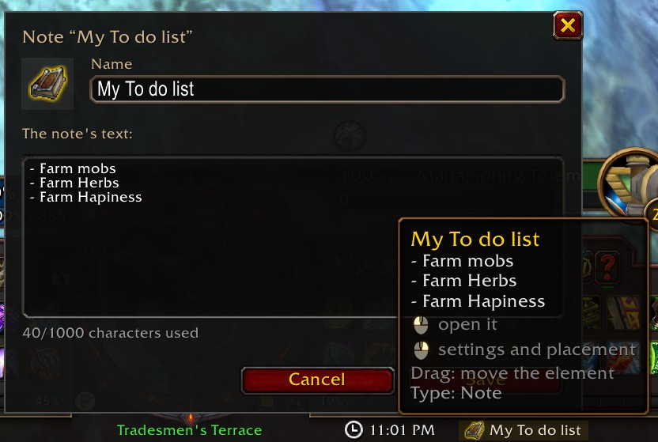
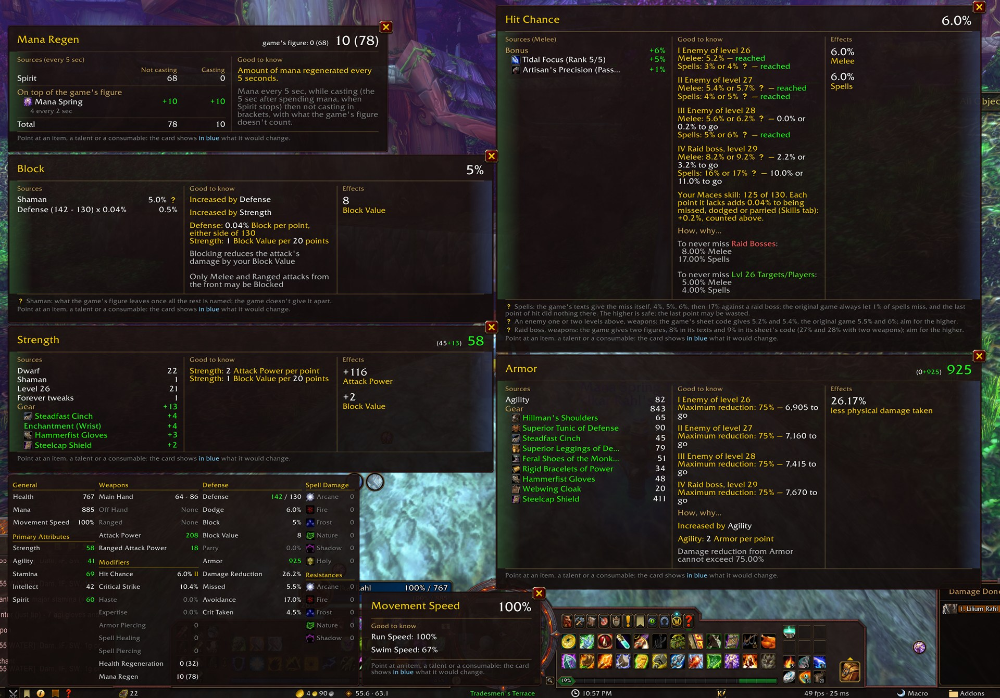

# KaLi HUD

**A metal base for Blizzard's own interface.** KaLi HUD lays a plate along the bottom of the screen that follows your action bars, minimap, chat and damage meter wherever Edit Mode puts them, with an info bar at its foot. For World of Warcraft Forever.

Install it and the plate is there. Shape it in **Edit Mode**: click the KaLi HUD strip along the foot of the screen, or type `/kh edit`. `/kh` opens the options.

> **Beta:** every feature is in. If something doesn't work, `/kh report` gives you a ready-made bug report.

---

## The plate

- **It follows your layout:** the action bars, stance, pet and totem bars, the micro menu, the bags, the chat, the damage meter and the minimap stay where Edit Mode puts them, and the plate draws round them. It never moves one, and outside Edit Mode it stands still.
- **Shaped your way:** its reach, corners, margins and recesses are settings.
- **Nine styles,** each a minimap ring and a color: Blizzard copper, silver, gold, forest green, rune taupe, steampunk bronze, gem pink and gold, astronomy blue and fire red. A style sets the ring, the border, the background, the cartouches and the corners at once, and asks before replacing a setting you changed.
- **The minimap in a dome** at its centre, with a choice of rings and Blizzard's own buttons round it or on the bar.
- **The chat and the damage meter fold away** into a cartouche on the plate, with an animation and a sound. Typing unfolds the chat.
- **Two progress bars** under the action bars: experience, the watched reputation or honor. Their tooltips list what raises what you gain: rest, a meal, an elixir, Diplomacy, Cenarion Favor.

## The info bar

- **Its own items:** the zone, the clock, bags, gold, repairs, experience, performance, speed and volume. The session item counts gold, experience, deaths and time; **New measure** starts it again, at a dungeon's door for instance.
- **Other addons' items** (LibDataBroker): a new one lands in the **Addons** folder, never on the bar. Drag out the ones you want.
- **The padlock** at its right end: shut, you use the HUD; open, it turns gold and you drag any item along the bar, round the minimap or into a folder. A fight shuts it.
- **Nothing moves by itself:** each item keeps its room, so a text that changes shifts nothing. What has no room goes into **More**, and comes back on the bar as soon as it fits.
- **Undo and redo** for the bar's last ten changes, from its menu or two keys to bind.
- **Fishing's tooltip** says where a cast lands in this zone; a skill's bonus says where it comes from.

## Folders, macros and notes

- **Folders** hold what you drag into them, and gather other addons' minimap buttons.
- **Ready-made folders:** the attributes, the emotes and the group's markers, statistics, reputations, skills and reagents. They're locked: KaLi HUD keeps them up to date, in your game's language. Drag something out of one and a copy lands where you drop it.
- **Lists your way:** icons, text or both, values aligned, in rows or columns, with named separators as section titles.
- **Macro buttons,** with a right-click and a tooltip of their own, and **notes** that open with a click.

## The character sheet, on a hover

- **Every attribute on the bar,** its hover a card: its value, where it comes from (the base, each worn item and its enchantment, sets, buffs, talents, your race and class) and what it gives, each source with its icon.
- **What's worth reaching:** hit, defense, expertise, armor and resistances against an enemy of your level, one or two above, and a raid boss, with what's missing.
- **Try before you wear it:** with a card kept open, hover an item, a talent, an elixir or a meal to see what the value would become.
- **Mana and health regeneration** as tables: casting or not, standing, seated or in a fight, with what the game's own figure doesn't count.
- **Honest figures:** what a card works out rather than reads from the game wears a question mark, and its foot says why.

## Presets and sharing

- **Presets:** everything you set, kept under a name. Apply all of it or only some parts.
- **Share** a preset as a text another player imports; it changes nothing until they apply it.
- **The account's settings, or this character's own.**
- **Nothing of yours is reset or dropped without a question.**

## Safe with the game

- **Blizzard's frames stay Blizzard's:** KaLi HUD never moves them. The unit frames, cast bars and nameplates are left to Blizzard, or to FlareUI.
- **Sturdy:** a button that can't be placed is left out, a change that fails halfway is put back whole, and a part of the HUD that fails to load is named while the rest starts.
- **Turn off what you don't want:** the plate, the info bar and the minimap's dome each have their switch. With the info bar off, other addons' minimap buttons go back on the minimap.
- **Nothing else to install:** no libraries, no dependencies.

## Compatibility

- **Action bar addons:** KaLi HUD works with most of them.
- **Left alone:** the player, target, party and raid frames, and in general anything that comes and goes during play: buffs, spells and the rest are for the game or your other addons.

## Slash commands

| Command | What it does |
| --- | --- |
| `/kh` | Opens the options |
| `/kh edit` | Opens Edit Mode with KaLi HUD picked |
| `/kh export` / `/kh import` | Shares your settings as a text |
| `/kh stats` | Keeps every attribute card as it is, for a bug report |
| `/kh report` | Reports a bug |
| `/kh help` | Lists every command |

## Questions

**Does it replace my action bars or my unit frames?**
No. Blizzard's bars, minimap, chat and damage meter stay Blizzard's: KaLi HUD draws its plate round them. Unit frames, cast bars and nameplates are left alone.

**How do I move things?**
In Edit Mode, as usual: the plate follows. Its own settings are in the dialog that opens when you click the KaLi HUD strip.

**Where did another addon's minimap button go?**
Into the **Addons** folder on the info bar. Drag it out with the padlock open, or turn the info bar off to put the buttons back on the minimap.

**Something disappeared from the bar?**
It may be in **More**, waiting for room. Anything you removed comes back from the bar's right-click menu.

**Can my characters have different settings?**
Yes. Settings are the account's by default; a character can have its own, set in **Presets**.

## Languages

French, English, German and Spanish (Spain and Mexico), as your game client is set; other clients get English. Everything the game names comes from the game itself, in its language. The German and Spanish texts are new: if a word reads wrong, tell us in a bug report.

## Install

The CurseForge app installs and updates it. By hand: put the `KaLiHUD` folder in `World of Warcraft\_forever_\Interface\AddOns`, then restart the game.

## Bugs and ideas

`/kh report`, **Report a bug** in the info bar's right-click menu, or **Help** on the options page opens a window with a report of what the addon sees, to copy. It holds no character or realm name. Please say what you were doing and what happened. A figure looks wrong somewhere particular (at a camp, after a level-up, in a form)? Type `/kh stats` there first.

- **With a GitHub account:** **Select the link**, copy it (Ctrl+C) and open it in your browser: a new issue opens, its questions in it. Then **Select the report**, copy it and paste it in. You can also open an issue directly: [github.com/Ikar-Rahl/Warcraft-KaLi/issues](https://github.com/Ikar-Rahl/Warcraft-KaLi/issues).
- **Without one, by mail:** click the address under the link, copy it, and write to [warcraft.kali.addons@gmail.com](mailto:warcraft.kali.addons@gmail.com) with the report pasted in. Within a few minutes your mail becomes an issue and you get its link: what you write is published there, your address never is. The answers come back to you by mail; reply to them to add to the issue.

Ideas and questions are welcome either way; by mail, say *idea* or *question* in the subject.

## Credits

KaLi HUD stands on other modders' work. What it owes each:

- **[FlareUI](https://www.curseforge.com/wow/addons/flareui) by Malkkav** (MIT License): KaLi HUD's look started from it, its bronze and the grain along a border, and its status bars are drawn and filled as FlareUI's XP bar. Code adapted from FlareUI's, under its license: part of the color palette, the status bars' colors, the folding bag bar, and the patterns that keep the minimap and the windows working with it (the notice is in KaLi HUD's LICENSE). FlareUI's art isn't shipped: KaLi HUD's textures are its own.
- **[Titan Panel](https://www.curseforge.com/wow/addons/titan-panel) by the Titan Panel Team**, HonorGoG and urnati, and before them TitanMod, Dark Imakuni and Adsertor: the information bar with plugins, which KaLi HUD's info bar takes on. The idea only: KaLi HUD's code is its own.
- **[SexyMap](https://www.curseforge.com/wow/addons/sexymap) by Funkeh:** the minimap dressed in a choice of borders, which KaLi HUD's dome and its rings take on. The idea only: KaLi HUD's code is its own.
- **[SpartanUI](https://www.curseforge.com/wow/addons/spartan-ui) by wutname1:** the status bars along the foot of the screen, under the bars, as KaLi HUD's two lie along its info bar. The idea only: KaLi HUD's code is its own.
- **[SinStats Character Stats](https://www.curseforge.com/wow/addons/sinstats) by Sinba:** the thresholds against a target of another level, which the attribute cards show against your target. The idea only: KaLi HUD's code is its own.

## Source and license

Open source under the MIT license: [github.com/Ikar-Rahl/Warcraft-KaLi](https://github.com/Ikar-Rahl/Warcraft-KaLi). The cartouches and the minimap rings are cut from images generated with Google Gemini; parts of the colors and window handling are adapted from FlareUI, under the MIT license.
