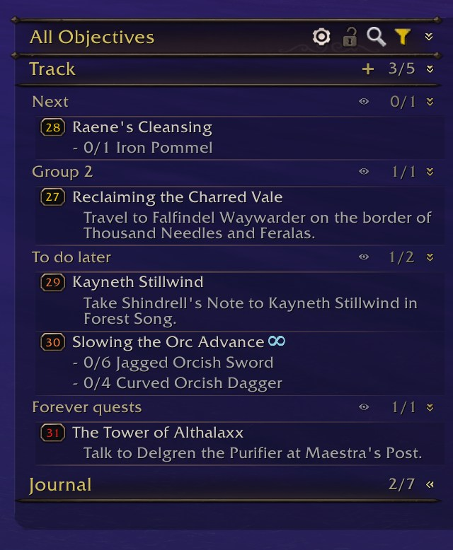
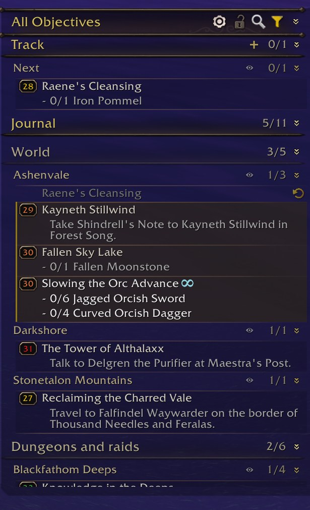
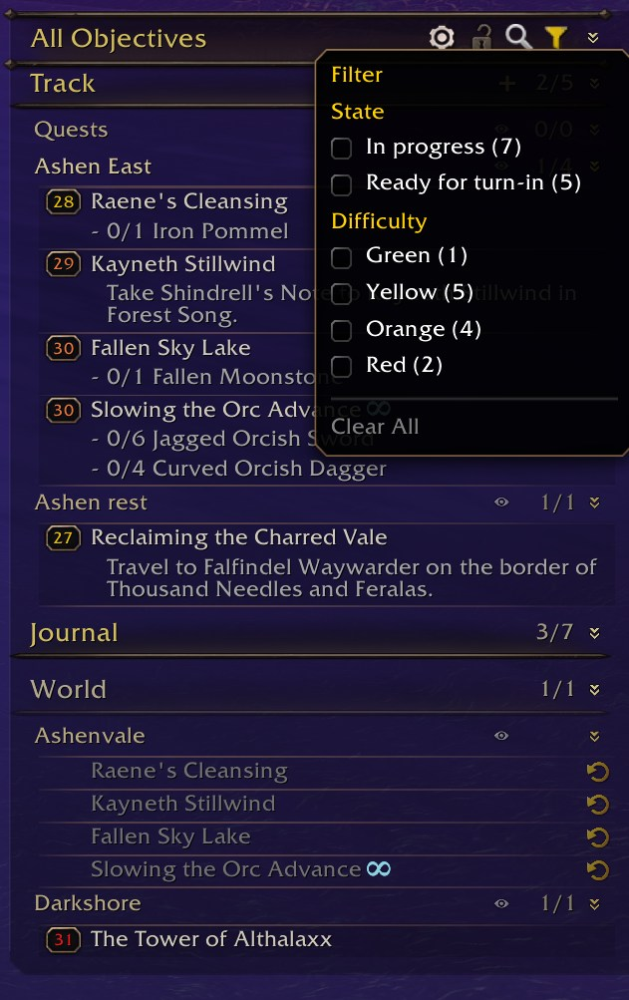
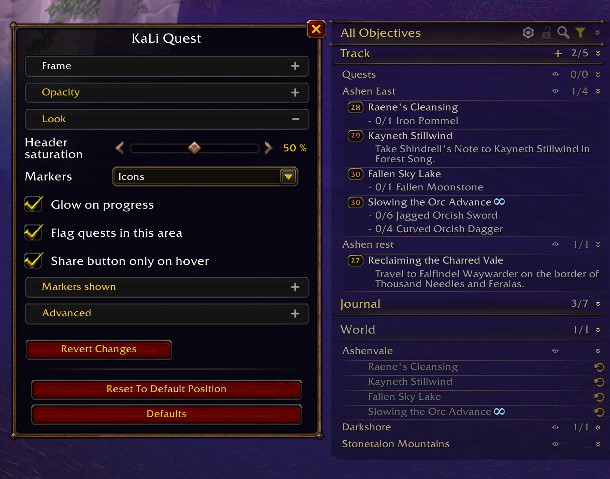

# KaLi Quest

**Sort your quests your way.** KaLi Quest redraws Blizzard's objective tracker around groups you make yourself: the quests you care about on top, the rest of your log neatly sorted below. For World of Warcraft Forever.

Install it and the tracker is there. Type `/kq options`, or open **Options > AddOns > KaLi Quest**, for the rest.

> **Beta:** every feature is in. If something doesn't work, `/kq report` gives you a ready-made bug report.

---

## Your groups

- **Make your own groups** under the **Track** bar: name them, order them, open one and close the others.
- **A quest in a group is tracked by the game.** Everything else stays in the **Journal** below, sorted by zone and kind, whatever your client's language.
- **Drag and drop** a quest into a group, or a group or a Journal bar to reorder it. Drop a quest on the Track bar to start a new group.
- **Pick several quests** with Ctrl+click, then move, track or share them all at once.
- **Shift+click** tracks or untracks a quest: the game's tracking and your groups follow each other.
- **Past the game's 25 tracked quests**, a quest you placed by hand stays in its group, marked "Off list".
- **Deleted a group by mistake?** Undo it from the gear's menu.

## Find what you need

- **Search and filters:** ten kinds of filters (type, group size, repetition, state, difficulty, classification, story, account and faction, party, place), each choice with its count.
- **Markers** for dungeons, raids, PvP and more.
- **Quests in the area you're in** get a gold arrow; a group or a bar shows how many it holds.
- **A glow** on the quest that just progressed.

## Out of your way

- **The padlock** freezes what's open and the order. A fight locks it until it ends.
- **Key bindings**, unbound at first: lock, collapse, next and previous group.
- **Edit Mode:** the tracker is a frame of its own, like Blizzard's. Drag it with snapping, keep a place for each layout, and set its size and look in one dialog, with a cancel.
- **Nothing lost:** quest items, popups, timers, tracked recipes and achievements show as in Blizzard's tracker.

## Safe with the game

- **Blizzard's tracker comes back by itself** if the addon meets an error, or if a tracker section it doesn't draw fills.
- **No taint:** Blizzard's tracker keeps its own size, so its updates never run tainted by the addon, in a fight or out of it.
- **Your data is kept safe:** groups are saved per character, and saved data the addon can't read, or that a newer version wrote, is left untouched.
- **Back to Blizzard's any time:** untick "KaLi Quest's tracker" in the options, or type `/kq tracker off`.
- **Nothing else to install:** no libraries, no dependencies.

## Slash commands

| Command | What it does |
| --- | --- |
| `/kq` | Lists every command |
| `/kq options` | Opens the options |
| `/kq tracker on` / `off` | KaLi Quest's tracker, or Blizzard's |
| `/kq report` | Reports a bug |

The options' **Tips** page lists every shortcut, and what doesn't show at first glance.

## Questions

**Does it change the quest log or the map?**
No. KaLi Quest only draws the objective tracker. A click on a quest opens it on Blizzard's map.

**How do I move or resize the tracker?**
Open **Edit Mode** and click the tracker. The options page and the gear's menu have a button that opens Edit Mode with the tracker already picked.

**Are my groups shared between my characters?**
No, each character has its own groups.

**Why does a quest say "Off list"?**
The game tracks 25 quests at most. Past that, a quest you put in a group stays there, marked, instead of disappearing.

**How do I go back to Blizzard's tracker?**
Untick "KaLi Quest's tracker" in the options, or type `/kq tracker off`. Tick it again, or `/kq tracker on`, to come back.

## Languages

French, English, German and Spanish (Spain and Mexico), as your game client is set; other clients get English. Quest, place and character names come from the game itself. The German and Spanish texts are new: if a word reads wrong, tell us in a bug report.

## Install

The CurseForge app installs and updates it. By hand: put the `KaLiQuest` folder in `World of Warcraft\_forever_\Interface\AddOns`, then restart the game.

## Bugs and ideas

`/kq report`, or **Report a bug** at the bottom of the gear's menu, gives you a link that opens a new issue on GitHub with its questions, then a report of what the addon sees to paste into it. The report holds no character or realm name; you need a GitHub account. Please say what you were doing and what happened.

You can also open an issue directly: [github.com/Ikar-Rahl/Warcraft-KaLi/issues](https://github.com/Ikar-Rahl/Warcraft-KaLi/issues)

## Source and license

Open source under the MIT license: [github.com/Ikar-Rahl/Warcraft-KaLi](https://github.com/Ikar-Rahl/Warcraft-KaLi)
