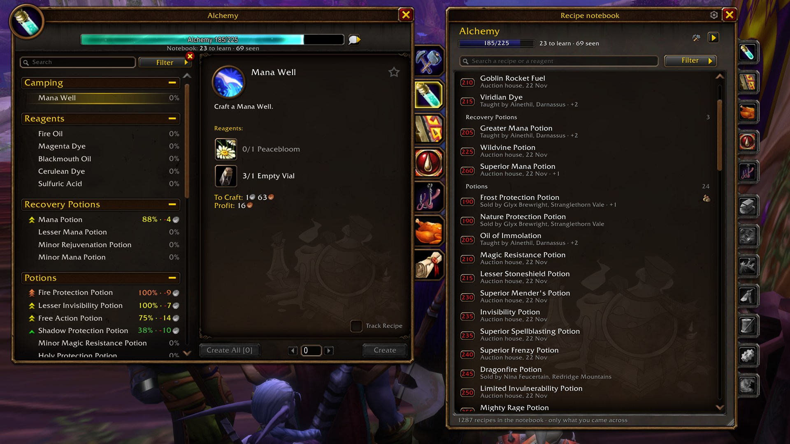
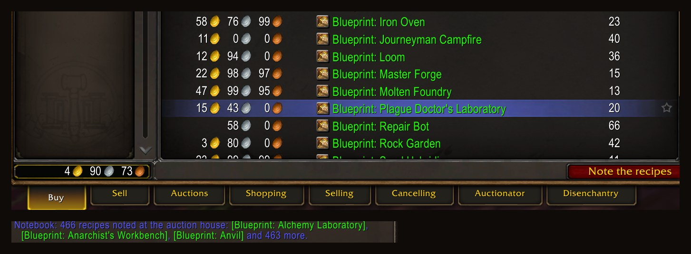
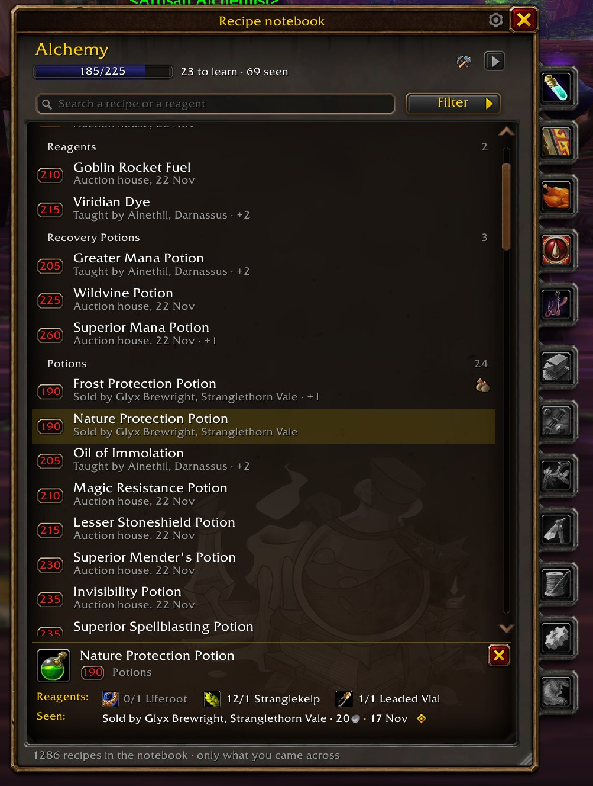
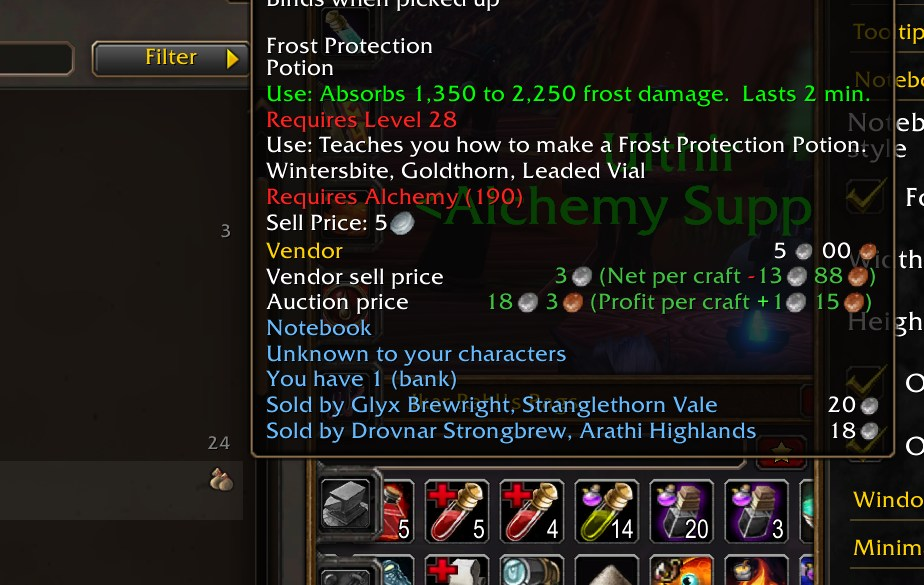

# KaLi Recipe

**Never lose track of a recipe you came across.** KaLi Recipe keeps a notebook of every recipe you meet, at vendors, trainers, the auction house, on loot and as quest rewards, and tells you which ones you can learn now. It only knows what you saw: nothing you never met can show. For World of Warcraft Forever.

Install it and play: recipes are noted as you meet them. The notebook opens from the minimap button, the addon compartment, or `/kr`.

> **Beta:** every feature is in. If something doesn't work, `/kr report` gives you a ready-made bug report.

---

## Noted where you meet them

- **Vendors and trainers:** every recipe they offer is noted, with where you saw it and the price asked. A gray clock marks a vendor whose stock of it was limited.
- **The auction house:** your searches there note the recipes they list. **Note the recipes** searches every recipe on sale, only when you click it: the addon never searches by itself.
- **Loot:** a recipe looted is noted with who dropped it and where.
- **Quest rewards:** noted as soon as the quest is offered, before you accept it, with the quest giver and where they stand. The quests already in your log count too.
- **Your bags:** a recipe arriving there is noted as well.
- **One chat line per visit**, in the professions color, and a sound: the quest log's quill for a recipe new to your notebook, a short stroke of it for a new place of one already in it. Both are the game's own sounds; pick others, or none, and their volume in the options.
- **Every profession**, even those this character doesn't have.

## The notebook

- **"Notebook: 7 to learn · 4 seen"** under the rank bar of the professions window, and under each profession in the professions book: the recipes you can learn at your rank, and those seen whose required rank is higher. A click opens the notebook.
- **Three lists per profession:** **To learn**, **Seen** and **Learned**, by the game's own categories, with a search (a recipe or a reagent) and filters (categories, sources, who holds it).
- **A recipe's detail:** what it makes, its reagents with how many you have, where it was seen with a waypoint, its required rank, which of your characters hold it and which know it.
- **Two styles:** **Clean**, a game window, and **Book**, the profession's quest page, each with the profession's art. Resize it from its corner.
- **Follow the professions window:** the notebook opens with it, docks against it and follows the profession open there.

## Marks and tooltips

- **Marks on recipe items** at vendors and in your bags, Blizzard's and Baganator's: the objective tracker's check when learned, the required rank in its difficulty color, in red when too high, a banker icon when this character holds it, a friend icon when another of your characters does.
- **Crafted items** carry the profession's small icon: bright if this character can make it, dimmed otherwise.
- **A recipe's tooltip** says who knows it, who holds it, where it was seen and what a vendor or trainer asked: detailed, on one line, or nothing.
- **A reagent's tooltip** lists what it's **Used in**: the recipes your characters know, then those you came across, in gray. A crafted item's says who it's **Made by**.
- **Hovering a vendor** says whether you visited it, and how many recipes you saw there. Your other characters' visits count.
- **At the auction house,** no marks on the rows: the recipe's tooltip says it all, in Blizzard's list and in Auctionator's.

## On the map

- **Pins on the world map** where recipes this character doesn't know were seen. A quest reward's pin is the game's yellow "!" of a quest offered.
- **A waypoint** from the notebook's detail, to walk back there.

## Your data

- **Shared by all your characters:** what one sees counts for all, and each one's bags, bank and known recipes show on the others.
- **Kept safe:** each character keeps a copy of the notebook in its own file, which brings it back if the account's file goes missing. Nothing a later version adds is lost, and nothing unreadable is deleted, only set aside. `/kr data` shows its state.
- **Noted by mistake?** `/kr forget <recipe>` removes it.
- **Nothing else to install:** no libraries, no dependencies.

## Opening it

- **The notebook:** the minimap button, the addon compartment, a click on "Notebook: …", or `/kr`. Information bars such as Titan Panel list "KaLi Recipe" too.
- **The options:** the gear at the top right of the notebook, a right-click on any of those buttons, or `/kr options`. They open in a window of their own, beside the notebook, which stays open while you set them. **Options > AddOns > KaLi Recipe** has a button to it.

## Compatibility

- **[Auctionator](https://www.curseforge.com/wow/addons/auctionator):** a recipe's tooltip says what KaLi Recipe knows in Auctionator's list as in Blizzard's.
- **Baganator:** its bags get the same marks on recipe items as Blizzard's.
- **Information bars** such as [Titan Panel](https://www.curseforge.com/wow/addons/titan-panel) list "KaLi Recipe", to open the notebook.

## Slash commands

| Command | What it does |
| --- | --- |
| `/kr` | Opens or closes the notebook |
| `/kr options` | Opens the options |
| `/kr forget <recipe>` | Removes a recipe noted by mistake |
| `/kr data` | The saved data's state |
| `/kr report` | Reports a bug |
| `/kr help` | Lists every command |

## Questions

**Does it show recipes I haven't met?**
No. It only knows what you saw. WoW Forever hides the recipes you haven't learned, and KaLi Recipe keeps that surprise.

**Does it search the auction house by itself?**
No. It notes what your own searches list. **Note the recipes** searches every recipe on sale, only when you click it.

**Do my characters share the notebook?**
Yes. What one sees counts for all, and the marks and tooltips show what each of them knows and holds.

**Does it work with Baganator and Auctionator?**
Yes. Baganator's bags get the marks. At the auction house, Auctionator's searches are noted, and the recipe's tooltip lines show in its list.

## Languages

French, English, German and Spanish (Spain and Mexico), as your game client is set; other clients get English. Quest, place, character, recipe, item and profession names come from the game itself. The German and Spanish texts are new: if a word reads wrong, tell us in a bug report.

## Install

The CurseForge app installs and updates it. By hand: put the `KaLiRecipe` folder in `World of Warcraft\_forever_\Interface\AddOns`, then restart the game.

## Bugs and ideas

`/kr report`, or **Report a bug** at the end of the options (the notebook's gear) or on KaLi Recipe's page in the game's options, opens a window with a report of what the addon sees, to copy. It holds no character or realm name. Please say what you were doing and what happened.

- **With a GitHub account:** **Select the link**, copy it (Ctrl+C) and open it in your browser: a new issue opens, its questions in it. Then **Select the report**, copy it and paste it in. You can also open an issue directly: [github.com/Ikar-Rahl/Warcraft-KaLi/issues](https://github.com/Ikar-Rahl/Warcraft-KaLi/issues).
- **Without one, by mail:** click the address under the link, copy it, and write to [warcraft.kali.addons@gmail.com](mailto:warcraft.kali.addons@gmail.com) with the report pasted in. Within a few minutes your mail becomes an issue and you get its link: what you write is published there, your address never is. The answers come back to you by mail; reply to them to add to the issue.

Ideas and questions are welcome either way; by mail, say *idea* or *question* in the subject.

## Source and license

Open source under the MIT license: [github.com/Ikar-Rahl/Warcraft-KaLi](https://github.com/Ikar-Rahl/Warcraft-KaLi)
